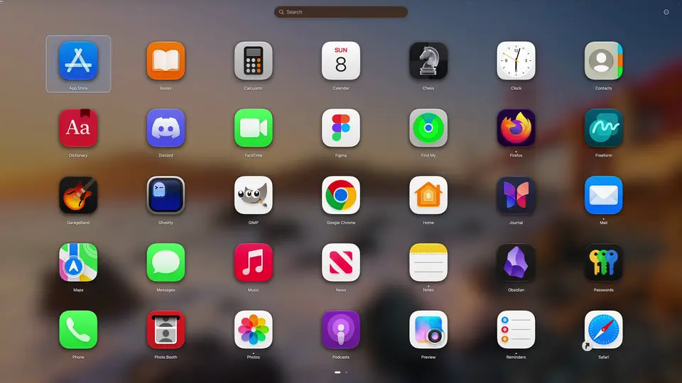

# LaunchGrid

A free, full-screen app grid for macOS 14+: pages, folders and type-to-search, one keystroke away. Everything is included; there are no purchases, licence checks, network calls or announcements.

[](https://launchgrid.sglavoie.com/)

Three things to try first:

- **Type `5 km in mi`**, `12*7` or `3pm in Tokyo`. The answer appears under the search field as you type, and Return copies it.
- **Pinch** on the trackpad. The grid follows your fingers onto the screen, and spreading them puts it away.
- **Sort Everything by Colour** from the ⋯ menu. Every icon sweeps into place, red through purple, in one wave. ⌘Z puts it all back.

About 99% of LaunchGrid (code, tests, documentation and website) was written by AI, Claude by Anthropic, directed and tested by Sébastien Lavoie. The app itself contains no AI features and makes no network connections.

## Install

Download `LaunchGrid.zip` from the [latest release](https://github.com/sglavoie/LaunchGrid/releases/latest), unzip it and move LaunchGrid to your Applications folder. Or use [Homebrew](https://brew.sh): `brew install --cask sglavoie/tap/launchgrid`, and `brew upgrade` for updates. It is signed and notarised, and runs on Apple silicon and Intel Macs with macOS 14 or later.

## Build and run

```sh
scripts/bundle.sh            # release build → build/LaunchGrid.app (ad-hoc signed, hardened runtime)
open build/LaunchGrid.app
scripts/install.sh           # build, quit the installed copy, replace /Applications/LaunchGrid.app, relaunch
swift test                   # core and app-state tests
```

With [just](https://github.com/casey/just), `just` lists shortcuts for these: `just install`, `just uninstall` (removes the login item, quits and deletes the app, keeps your layout and settings), `just run`, `just scratch` (a throwaway layout and separate settings, beside the installed copy, logs in the terminal), `just sandbox` (the build signed with the Mac App Store sandbox, run as a first launch: its container is set aside and put back when it quits, and `just sandbox --keep` keeps it instead; quit the installed copy first), `just test`, `just test-app-store`, `just ci` and `just clean`.

CI (`.github/workflows/ci.yml`) builds, tests and bundles on macOS 26, runs the tests again against the Mac App Store variant (`just test-app-store`) and checks `scripts/*.sh` with shellcheck.

`just test-ui` builds a debug bundle and runs the UI regression scenarios in `scripts/ui-tests`.
Run it on a test Mac with a logged-in graphical session, including over SSH: it opens windows
and sends keyboard and mouse events through the app. Each scenario has a fixed fixture catalog,
a fresh layout and a unique settings domain; it leaves your installed layout and interactive
scratch settings alone. It does not start scans, folder watchers or the global shortcut. Keep
the test session idle while it runs. No Screen Recording or Accessibility permission is needed.
`just test-ui --no-build` reuses the bundled app; append a scenario path to run just that case.
State assertions wait up to three seconds, and each process has a 60-second timeout (override
with `UI_TEST_TIMEOUT`). Logs, the scenario, the final state/layout and a JSON result stay in
`build/ui-tests/<run>/<scenario>/`; failures also capture the app's window contents, including
hidden windows. CI runs the scenarios against the downloadable bundle and uploads artifacts
on failure. The runner is compiled out of the Mac App Store build. See
[`scripts/ui-tests/README.md`](scripts/ui-tests/README.md) for adding scenarios.

The website at [launchgrid.sglavoie.com](https://launchgrid.sglavoie.com/) (home, support and privacy policy) is static HTML in `website/public`, served by a Cloudflare Worker: `just website` previews it. Pushing a change under `website/` to `main` publishes it (`.github/workflows/website.yml`), after `scripts/check-website.sh` confirms that every file and `#anchor` the pages refer to exists (pull requests run the same check); `just website-deploy` does the same by hand. `docs/app-store-submission.md` tracks what the Mac App Store still needs. The video and Settings screenshots on the home page come from `just demo-video` (`scripts/record-demo.sh`), which drives a scratch copy through `scripts/demo/story.txt` and `scripts/demo/settings.txt` with the apps in `scripts/demo/apps.txt`; edit those and run it again to refresh them. It also turns the video into the animation at the top of this README (`scripts/readme-demo.sh`, which can be run alone; GitHub doesn't play a video file in a README), and the website workflow fails when `docs/readme/demo.webp` wasn't made from the current video. It needs ffmpeg, cwebp, img2webp and Screen Recording permission for the terminal you run it in.

Installing to `/Applications` is needed for "Open at login". `scripts/install.sh --no-open` skips the relaunch, and `INSTALL_DIR=~/Applications` installs elsewhere. It falls back to `sudo` when the folder isn't writable, and registers the installed copy as the `.launchgrid` handler. Only the copy at the install path is quit (LaunchGrid saves and quits on `SIGTERM`), so a `just scratch` run keeps going.

Release a new version from a clean `main` checkout with one command:

```sh
just release patch                     # 1.0.1 → 1.0.2
just release minor                     # 1.0.1 → 1.1.0
just release major "Release notes"     # 1.0.1 → 2.0.0; notes are optional
just release 1.3.0                     # sets the version directly
just release --force 1.3.0             # publishes without waiting for or checking CI
```

These commands bump `VERSION` in `scripts/bundle.sh`, commit it, push `main` to `origin` (including any local commits), wait for that commit's CI to pass, build the signed and notarised universal app, create the GitHub release and update the Homebrew cask in [sglavoie/homebrew-tap](https://github.com/sglavoie/homebrew-tap). They require an authenticated `gh`, your Developer ID in the keychain (or `SIGN_IDENTITY`), the notarisation credentials described in `scripts/release.sh`, and a clean tap clone. The scripts use `TAP_DIR` when set, otherwise look for `../homebrew-tap` or `../sglavoie_homebrew-tap`; if neither exists, they clone `sglavoie/homebrew-tap` into `../homebrew-tap` automatically. An explicit `X.Y.Z` can be below the current `VERSION` (to reuse a number whose release never shipped) but must be above every `v*` and `app-store/v*` tag. `--force` (anywhere before the notes) is the same as `SKIP_CI_CHECK=1`: the release ships even if CI's tests fail. If interrupted after the version commit, fix the failure and run `just release resume` with any release notes again; it keeps the current version and reuses the zip when it belongs to the current commit. If only the cask update failed, `just publish` retries it directly.

`just release` with no arguments still only builds `build/release/LaunchGrid.zip`; `just publish` publishes that build and updates Homebrew. This also supports manually editing the version, committing and pushing before building once CI passes. `release.sh` and `app-store.sh` check CI; after a documentation-only or website-only push whose tests were skipped, they look back to the commit whose tests ran. `SKIP_CI_CHECK=1` skips the CI wait and check. The downloadable build is **not sandboxed**, so it can scan any folder and read the old Launchpad/AppGrid databases without asking.

`just app-store` (`scripts/app-store.sh`) makes the Mac App Store build: the same code in the App Sandbox (`scripts/LaunchGrid.entitlements`), without the debug scripts, signed with Apple Distribution and packaged as `build/app-store/LaunchGrid.pkg`; `just app-store --upload` sends it to App Store Connect and tags the commit `app-store/vVERSION`, so neither script builds that version again from another commit. The script's header describes the certificates and provisioning profile it needs. Inside the sandbox, LaunchGrid keeps security-scoped bookmarks to the extra scan folders, the custom background picture and apps added with Browse (`FileAccess` in `Services.swift`), and the AppGrid and Launchpad imports first ask for the database's folder. `~/Applications` is read through a temporary-exception entitlement. Both builds ship `scripts/PrivacyInfo.xcprivacy`.

On first launch, a welcome window lets you choose which installed apps to include (all by default), then offers these ways to set up the grid:

- Build by category.
- Build alphabetically.
- Build by colour (a rainbow across the pages, which builds itself in tile by tile).
- Import from AppGrid (if its database exists).
- Import from Launchpad (if the pre-macOS 26 database still exists).
- Load a grid file.

## Using it

| | |
|---|---|
| Show / hide | **⌥Space** (change in Settings), the menu-bar icon, or the Dock icon. Both icons' menus (right-click) hold Settings, Add Missing Apps, Sort Everything, grid files, imports, Rebuild from Scratch and About. Optionally a trackpad pinch or a hot corner (Settings › General › Gestures) |
| Launch | Click, or arrow keys + Return |
| Search | Just type. Results rank prefix > word start > initials ("vsc") > substring > fuzzy; within each kind of match, what you open most and lately comes first (kept in the settings, by app or action, with only the time LaunchGrid opened it). The letters typed show in bold, and results slide to their new places as you type. Return opens the first result, ⌘1…9 the result with that number, ⌘Return shows it in Finder and ⌘Y opens Quick Look on it; holding ⌘ shows those keys under the search field. ⌘F clears the search to start again. With no results, actions that take an argument are offered to run with what you typed (Return runs the first), or a way to make one. An action's keyword followed by a space turns into a token at the start of the search. System Settings panes come after everything in the grid: "bluetooth", "displ" or "dark mode" offers that pane (marked "System Settings"), and Return opens it there; only panes this Mac has, found by their names or other words for them, never by a letter here and there (Settings › General › Search turns this off). Starting a search lifts the matches out of the page into the results, and clearing it puts them back. The top hit stands alone on the first row, larger and centred, with a line under its name saying what it is, where it is and when it was last opened here ("Running · In Writing · Opened 2 hours ago"; left out in a grid too tight for it, rather than running into the row below); the rest follow in centred rows, and ↑/↓ go to the nearest result in the row above or below. Three results or fewer all stand on the first row, as large as the top hit |
| Answers | Sums (`12*7`, `=2^10`, `200 + 10%`), conversions (`5 km in mi`, `70 f to c`, `2 GB in MB`), times elsewhere (`3pm PST`, `15:00 utc in tokyo`, `time in london`), colours (`#ff8800`, `rgb(255, 136, 0)`, `#f80 in hsl`), dates (`days until dec 25`, `in 100 days`, `week number`), Unix timestamps (`1768478400`, `unix time`), number bases (`0x1F`, `255 in hex`) and Base64 (`base64 hello`, `decode aGVsbG8=`) are worked out as you type and shown as a card under the search field, with what kind of answer it is (a small clock for a time, light by day and dark by night, and "Tomorrow" or "Yesterday" when it falls on another day; a swatch for a colour); Return (or a click) copies the answer. Worked out from what you typed alone: nothing is looked up |
| Pages | Swipe, scroll (up and down too), ⌘←/→, Tab / ⇧Tab, Page Up/Down, Home/End (first and last page), ⌘1…9, click the page dots. Plain ←/→ turn the page too before an item has focus or past a page's end. ⌘N adds a page after the current one |
| Esc | Clears search → closes folder (focus returns to it) → leaves edit mode → clears the selection → hides |
| Edit mode | ⌘E, long-press an icon, or ⋯ › Edit Layout. Clicking selects instead of launching; clicking a search result (or Return) shows it where it is, its folder open, with keyboard focus on it. ✕ removes an item; it shows on the tile under the pointer, the focused one and the selected ones, not on every tile at once. A selected tile glows in its icon's colour, with a tick at the icon's corner; with the keyboard, Return opens the focused folder and renames the focused app (or the open folder, so Return twice renames a folder), ⌫ removes it and ⌥ + arrow keys move it (with the rest of the selection) one slot, onto the next or previous page past either end |
| Select | ⌘-click / ⇧-click, ⌘A, or Space on the focused item. Then drag them together, **Group** (⌘G), **Remove** (⌫), or Move to Page |
| Drag & drop | Drop in a gap to reorder. Hold over an app for a moment to make a folder, or over a folder to add to it. Hold at the screen edge to flip pages, including onto a new page. Drag out of an open folder to take an app out. ⌥-drag a tile off the grid, which steps out of the way, to drop it on the Dock, a Finder window (an alias) or another app |
| Files | Dragging a file from Finder? Press ⌥Space while you hold it: the apps that open it stand out, the rest fade back, and dropping it on one opens it there. Resting on a folder opens it, and at a page's edge turns the page |
| Folders | A folder's tile is a pane of frosted glass the shape of an app icon, lit along its top edge and holding its first nine apps. Click the title to rename. Ungroup from the context menu. A folder disappears when its last app leaves |
| Undo / redo | ⌘Z / ⇧⌘Z, 50 levels, including imports, rebuilds and resizes. A removal or sort shows an **Undo** button in its message |
| Other keys | ⌘, opens Settings, ⌘W hides, ⌘Q quits. ⌘⌫ quits the focused app when it's running |
| Shortcuts | ⌘/ (or ⌘?) shows every shortcut, by section, over the grid; so do **Keyboard Shortcuts** in the ⋯ menu, the menu-bar and Dock menus and Settings › General, and searching "shortcuts" or "keys". Esc, Return, ⌘/ or a click outside closes it, and the search under it stays. Hold ⌘ for a moment to see the shortcuts that work right now: numbers on the search results and page dots, and a strip of the rest, which changes in a search, edit mode, a selection, an open folder or mid-drag (⌘1–9 carries what's dragged to that page) and ends with ⌘/. The grid's own menus (the ⋯ button, right-click, ⌃Return) show each item's shortcut beside it. All three read one list (`Sources/LaunchGrid/Shortcuts.swift`) |
| Running apps | A dot under each (Settings › Appearance) pops in as an app starts and shrinks away as it quits. Its menu adds Hide, Quit and Force Quit. Opened while the grid stays up, an app's tile has a ring turning round it until it has finished launching, where the Dock would bounce it |
| New apps | An app added on its own since it was installed has a blue dot beside its name until it's first opened, here or anywhere else |
| Icon style | Icons follow the style chosen in System Settings › Appearance (Default, Dark, Clear, Tinted): changed while LaunchGrid runs, they're drawn again the next time the grid shows. An icon macOS hands out as a placeholder while it renders the new style is drawn again until the real one comes. In the Default and Dark styles, Calendar shows today's date and Clock the time, its second hand turning while the grid is up, as the Dock draws them |
| Ready to open | With **Suggest apps** on, when one app is opened around this time of day far more than anything else (at least three times lately, and half as often again as the next), the grid shows with the keyboard focus already on it, if it's on the page shown: the shortcut, then Return, opens it |
| Tour | The first time the grid shows after the first layout is made, a card over its bottom has you try the three things above, one at a time and for real: `5 km in mi` types itself into search and Return copies the answer; **Sort by Colour** sends every icon into place in one wave, and ⌘Z (or **Put It Back**) undoes it; holding ⌘ shows the shortcuts that work right now. Each step moves on once it's done, or with **Next**; **Skip Tour** ends it. It starts by itself once; **Show Me Around** in the ⋯ menu takes it again |
| Firsts | The first answer shimmers and says that Return copies it. The first folder you make and the first action you run each get a message with a sparkle saying what to try next. Each happens once |
| Motion | Tiles lift under the pointer and sink while pressed, their shadow spreading and tightening with them. The keyboard focus is a glow in the focused icon's colour that glides from tile to tile. The grid settles in from its middle as it shows, or out of where it was called from: the pointer at the shortcut, the hot corner, or the menu-bar icon; an app you open zooms toward you as it hides (or pulses when the grid stays up). Open one that's already running, with a window on that display, and its icon flies to that window instead, a frame growing from it to the window's size, so the window is right where the flight ends. The background fades in over the desktop as the grid shows (a wallpaper or picture settling from slightly larger) and drifts a little as you turn the pages. The picture background also drifts a few points against the pointer. Hovering lights a tile with its icon's own colour, and resting on a folder fans out what's in it. Folders open out of their tile and close back into it, a dragged icon leans into the way it's moving and straightens when it stops, the tiles it passes spring aside, a dropped icon glides into place (or into the folder it joins), a sort sweeps each tile to its new place a moment after the one before, removed tiles shrink away as the rest close up, and the lit page dot stretches as you swipe. A page title rises in with its page, and an untitled page says its number for a moment. Turning past the first or last page bounces. A Force Touch trackpad taps as a drag opens a gap, readies a folder or turns a page. The first layout builds itself in tile by tile. With Reduce Motion, things change place without moving |
| Actions | Grid items that open a link or deep link, a file or folder (optionally with a chosen app), an Apple Shortcut, or run a shell command or one of your scripts (see [Actions](#actions)). Create one with **New Action…** in the ⋯ or background menu (it goes on that page) or the menu-bar and Dock menus; edit one with **Edit Action…** in its context menu, ⌘I, or Return in edit mode; Settings › Library lists them all. An action's **keywords** find it first in search: with `{query}` in its link, Shortcut input, command or script arguments, typing `gh launchgrid` and Return runs it with `launchgrid` in place of `{query}`. Turn off **Show on grid** to keep it to search only. **Test** runs it from the editor before saving; each save is one undo step. Opening a link hands it to your browser; LaunchGrid itself makes no connection |
| Right-click | Item: Open, Show in Finder, Quick Look, Hide, Quit and Force Quit (running apps), Edit Action (actions), Rename, Move to Page, Group, Remove. Background: page and sort actions, New Action. With the keyboard, ⌃Return opens the focused item's menu and ⇧⌃Return the ⋯ menu |

**Settings:**

- **General:** shortcut recorder with a conflict warning, open at login, Dock and menu-bar icons (the menu-bar one monochrome or in the logo's colours), auto-add new apps (at the end of the grid, as Launchpad adds them), and when to hide: after opening an app (off: apps open behind the grid and the last one comes forward when it hides), on a click in an empty area, or on switching Spaces. **Search:** System Settings panes in search (on by default), and **Suggest apps** (on by default): a row of the apps you open most around this time of day above the first page when it has no title (opens are counted in three-hour stretches of the day, kept with the other open counts, and only a habit shows), the keyboard focus on one that stands out (**Ready to open** above), and, when the last page has two or more empty rows, an "Opened Lately" shelf there with what you opened last that isn't on that page. **Gestures:** pinch to open (two fingers over the bare desktop, or thumb and three fingers anywhere once the system's own pinch is off in Trackpad settings; the grid follows your fingers, and spreading them on it closes it), and a hot corner. The pinch reads trackpad gestures through an event tap that only listens, never to keys; if macOS refuses it, Settings says so and asks for Input Monitoring.
- **Appearance:** Full Screen, Full Screen with Dock (the Dock and menu bar stay in view), or a resizable Window (with frames saved per display). Backgrounds: blurred desktop, wallpaper, Liquid Glass, solid colour or custom image (a picture that can't be read is flagged, and the blurred desktop shows instead). The glass over the grid (search field, buttons, folders, messages) takes on a hint of the background's most vivid colour: the wallpaper's (read from a dynamic wallpaper's still picture too), the picture's or the solid colour's; a grey one leaves it as it is, and so does Increase Contrast. On by default, off with *Tint the glass with the background's colour*. **Play sounds** (off by default): a breath of air as the grid shows, a tick as a page turns, a muted knock as a folder forms and a tap as a dropped icon lands. They're made in the app from a few lines of arithmetic, and they're silent when interface sound effects are off in System Settings › Sound. Icon size, labels (which grow with the icons) and a dot under running apps (as in the Dock); in a small window, icons shrink to keep their names in view, and names are left out when even small icons leave no room.
- **Layout:** grid rows × columns. A cell is never more than 1.3 times as wide as it is tall: a grid with fewer columns than its display suits stands centred, with margins beside it, rather than spreading its icons to the edges. The size that suits this display is offered beside them (five rows on most displays and enough columns to keep each cell a little wider than tall, so a wide display gets more columns rather than wide gaps; the first layout from the welcome window takes it). Resizing keeps every page as it is when they all still fit; otherwise it re-flows every item in order, filling each page before the next, and asks first when items would change page; each page takes the title of the page its first item came from. Folder placement when sorting; Sort Everything also clears page titles. **Sort Everything by Colour** (in the ⋯ and background menus, and the menu-bar and Dock menus) lays everything out by its icon's colour, red through purple, with grey icons last by name; ⌘Z undoes it.
- **Library:** every action, search-only ones too, with Edit, Remove and Show on grid; choose which apps to include or exclude, add missing apps (also ones from anywhere via Browse), extra scan folders (flagged when missing or unreadable, as are unreadable folders inside the scan folders), save/load `.launchgrid` files (double-clicking one in Finder loads it too; `.appgrid` files from earlier builds still load), import from AppGrid or Launchpad, rebuild (by category, alphabetically or by colour), regenerate icons.

## Actions

An action is a grid item you make, next to apps and folders: it can be placed, moved, renamed, searched for and undone like an app (folders hold apps and actions; folders don't nest). Its kind says what it does:

- **Link:** opens a web link or a deep link into another app (`https://…`, `obsidian://…`, `x-callback-url://…`) with the app that handles it. LaunchGrid itself makes no connection.
- **File:** opens a file or folder, with its default app or one you choose.
- **Shortcut:** runs an Apple Shortcut by name, with an optional text input. With no input set, the text typed after its keyword is the input.
- **Command:** runs a shell command (`/bin/zsh -l -c`, a login shell) in the background, where a badge on the tile shows it running or failed and **Show Last Output…** keeps the last 4 KB of its output and errors, or in a terminal (Terminal, iTerm, Ghostty or another app, set in Settings › General › Actions). Background commands stop after a time limit (60 s unless set) and can be stopped from the tile's menu. **Downloadable build only.**
- **Script:** runs a script you saved in `~/Library/Application Scripts/com.sglavoie.launchgrid/` (create it if it doesn't exist; **Open Scripts Folder** in the editor opens it), with arguments one per line. It must be executable (`chmod +x`), or an AppleScript (`.scpt`, `.applescript`). Works in both builds.

**Keywords** (comma-separated) put an action first in search, so a keyword and Return runs it; a keyword followed by text passes that text as the **argument**, which replaces `{query}` in a link (URL-encoded), a Shortcut's input, a command (as text the shell never runs, even inside quotes; the editor refuses `{query}` in backticks, `${…}`, arithmetic (`$((…))`, `((…))`, `$[…]`, subscripts like `a[…]` or `$#[…]`, even quoted), `[[ … ]]` tests that compare numbers or use `-v` or `-t`, glob qualifiers like `*(e:'…':)`, or here-documents, also when a `\` at the end of a line splits their operators across lines, and mixed into code another program runs: after `-c`, `-e` (or `-pe` and the like) of a shell, `osascript`, `sed` or a scripting language, in a `sed` or `awk` program given without `-e`, in `eval`, `trap`, `watch` or `ssh` (past the first word of the command they join, even as a whole argument: `eval echo {query}`), in a `<(…)` that a shell runs as its script, or in input piped, redirected or given with `<<<` to a shell, `osascript`, a scripting language or `at` that reads its program from it (`echo '…{query}…' | osascript`), where that program would run what's typed (as a whole argument, `sh -c {query}`, it is run on purpose), or as an argument of builtins that evaluate it even quoted: `let`, `integer`, `float`, `repeat`, `shift`, `exit`, `return`, `read`, `unset` and `vared`, a variable name for `typeset`, `declare`, `local` or `export` (`export X={query}` is fine), `printf` with a number format like `%d`, and `print -v` or `printf -v`, or as the value of a variable that holds a number, declared anywhere in the command (`typeset -i n` and then `n={query}`) or one of zsh's own like `SECONDS`) or a script argument (as is). Commands and scripts also get it in `LAUNCHGRID_QUERY` (except scripts in the Mac App Store build); a command that reads `$LAUNCHGRID_QUERY` takes an argument even without `{query}`. Turn off **Show on grid** for a **search-only** action, kept in the layout but on no page.

**The two builds.** The downloadable build isn't sandboxed and runs commands and scripts with `Process`, **with your own user's permissions**: a command can do anything you could do in Terminal. The Mac App Store build runs in the App Sandbox, which can't run shell commands: command actions show as unavailable there. It runs scripts from the Application Scripts folder through `NSUserUnixTask`, Apple's mechanism for this; macOS runs them outside the sandbox, so they too have your permissions, and LaunchGrid can't stop one once it has started.

**Grid files and review.** Actions are part of the layout, so undo, backups and grid files include them. Since a grid file can come from someone else, loading one (Load Grid File…, the welcome window, or double-clicking it in Finder) never runs anything. When it holds commands, scripts, links to other apps or files that run something when opened (an app, a `.command` or another executable, or any file opened with a terminal), a sheet first lists each with its name and full command, script, link or path, with **Keep for Review**, **Remove Them** (leaves those out) and **Cancel Loading**. Every action kept from a grid file shows an eye badge and, instead of running, opens in the editor with a note to check it; saving it there lets it run. LaunchGrid's own layout and its backups are never flagged. Saving a grid file leaves commands and scripts out unless you tick **Include commands and scripts** in the save panel: they're kept as placeholders with their names and icons, to fill in again.

## Where things live

- Layout: `~/Library/Application Support/LaunchGrid/grid.json`. This is pretty-printed, versioned JSON written atomically about 0.5 s after each change; an earlier save is kept beside it as `grid.json.bak`, refreshed at the first save of each run and then at most every 10 minutes, so a change you regret doesn't overwrite it straight away. The first refresh of each day also keeps the backup it replaces as `grid.backup-YYYY-MM-DD.json` (the last three days), which *Load Grid File…* opens. An unreadable file (or one from a newer version) is moved aside, never overwritten. An unreadable one is replaced by the backup when that can be read, with an alert saying so; otherwise the welcome window says where it went. If it can't be moved, nothing is saved until you move it yourself. A file with only some entries that can't be read loads without them, and a copy of it as it was is kept beside it (`grid.partial-….json`), with an alert saying so. A save that fails when you quit asks before quitting. Apps excluded in the welcome window are saved before the layout is made.
- Settings: `defaults read com.sglavoie.launchgrid`.
- The Mac App Store build keeps both in its container, apart from the downloadable build's: `~/Library/Containers/com.sglavoie.launchgrid/Data/Library/`, under `Application Support/LaunchGrid/` and `Preferences/com.sglavoie.launchgrid.plist`.
- Removed and excluded apps are remembered in the grid's `removedBundleIDs` (by path for a copy that shares its bundle ID, like Xcode-beta), so scans and rebuilds don't re-add them; *Choose Apps…* or *Add Missing Apps…* brings them back.

## How it's built

Two targets, each with a test target (`LaunchGridCoreTests`, `LaunchGridTests`):

- **`LaunchGridCore`**: pure, unit-tested logic.
  - `Model`: value-type `Grid`, which makes undo a snapshot.
  - `GridOps`: insert with overflow spill, move, group, reflow, sort.
  - `Reconciler`: add new apps, drop deleted ones, follow moved ones, keep the removed list. An empty scan prunes missing apps only when at least one scan root was listed; apps on an unmounted volume or under a folder that is missing or can't be listed stay put.
  - `AppScanner`: depth-limited, symlink-cycle-safe, skips bundle contents.
  - `Search` (with `Usage`, the decaying open counts it ranks by, and each name's query-independent forms worked out once), `GridStore`.
  - `Answer`: the sums, unit conversions, times elsewhere, colours, dates, timestamps, number bases and Base64 search shows under its field, from the text alone, with what kind each is.
  - `SettingsPane`: the System Settings panes search finds, with their links, symbols and other words for them.
  - `LaunchpadImporter`: reads a copy of the database and its write-ahead log; it handles Apple's multi-root DB, AppGrid's `custom_path` and `manual_app_*` IDs, and nested folder pages.
- **`LaunchGrid`**: the AppKit/SwiftUI app.
  - `OverlayController`: a non-activating `NSPanel`, so it takes keyboard focus without fighting cooperative activation. It shows on the screen under the pointer and handles key and scroll input.
  - `Interaction`: one root `DragGesture` with arithmetic hit-testing, dwell timers for merge, reorder and edge-flip, and a live gap; `SearchLayout`, where search results go (the top hit alone on the first row, the rest in centred rows; three or fewer side by side on the first), for drawing, file drops and the arrow keys.
  - `Polish`: hover and press (in the icon's colour), the staggered show, the background's entrance and drift (with the pages and against the pointer, `PointerDrift`), the opening zoom, folders zooming from their tile and their peek, the launch ring, the drop landing and trackpad haptics. The time from showing to the first frame is an `OSSignposter` interval ("Show") for Instruments; the debug step `showstats` prints this run's cold time and warm p50/p95. The panel is built and brought in once, unseen, soon after launch, so the first show is nearly as quick as the rest.
  - `Tour`: the first-run tour's steps (`TourStep`), what finishes each, and its card.
  - `Hints`: the answer under the search field, the key hints and shortcuts holding ⌘ shows, the search field's placeholder and the keyword token.
  - `Flight`: an opened app's icon flying to its window (`LaunchFlight`), from where `WindowFinder` reads the window's bounds (no window titles, so no Screen Recording permission).
  - `Delight`: the glass everything floating over the grid shares, the gliding keyboard focus, icon shadows, the live Calendar and Clock icons, the answer card and the first answer's shimmer, the suggestions row, the "Opened Lately" shelf and System Settings panes' tiles (and which panes this Mac has, read once from the bundle IDs in `/System/Library/ExtensionKit/Extensions`).
  - `Sounds`: the optional sounds, synthesised once into buffers and played through an `AVAudioEngine` that runs only while they play.
  - `FileDrop`: files dragged over the grid, onto the app that opens them; tiles ⌥-dragged off it.
  - `Gestures`: the pinch (a listen-only event tap, as AppKit's global monitors don't see pinches) and the hot corner.
  - Carbon hotkey, FSEvents watcher with a debounced rescan (plus a 10-minute and on-wake fallback), icon cache rendered off the main thread, `SMAppService` login item.
  - User-facing strings go through `String(localized:)` or SwiftUI's `LocalizedStringKey`. `Localizable.xcstrings` holds their plural forms and, later, translations; `scripts/bundle.sh` compiles it into the bundle with `xcstringstool`, so `swift build` and the tests show the English keys.

**Development aid:** `LAUNCHGRID_DEBUG_SCRIPT="build:alpha;show;drag:0,3;merge:1,2;snap:x;quit"` drives the UI with synthesized events and writes window snapshots to `LAUNCHGRID_DEBUG_DIR` (`film:open=6|5|40|name` does something, then snaps five times, waiting 40 ms before each, though a snap itself takes a while; `polish` prints the motion state). It only runs together with `LAUNCHGRID_DATA_DIR`, so it never edits your real layout; otherwise it's ignored with a note on stderr. It's left out of the Mac App Store build. `LAUNCHGRID_DATA_DIR` points the app at a scratch layout and the `com.sglavoie.launchgrid.scratch` settings domain, and lets it run beside the installed copy (which keeps the global shortcut). See `Sources/LaunchGrid/DebugScript.swift`.

### Deliberately left out

- In-app purchases, licence checks and anything else that needs a network connection.
- Announcements and release notes inside the app.
- `.lmy` import, whose format is unverified. `.agrid` files load through the SQLite importer.

## Licence

MIT; see [LICENSE](LICENSE).
